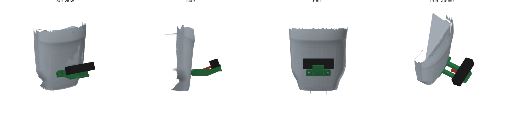
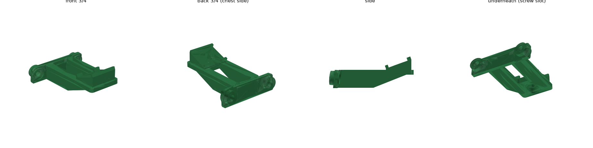

# Brio chest bracket for the G1

A 3D-printed bracket that holds a Logitech Brio 4K on the G1's chest, looking forward and 20°
up. It bolts to the two **lower front M6 holes** that Unitree provides for accessories.

The Brio's clip comes off. The camera's own ¼" tripod thread is under the camera body, hidden by
the clip (Logitech: remove the clip and the thread is exposed), so the bare camera sits on a
tilted seat and one screw holds it from below. The USB-C plug goes out through a gap in the back
stops, and the shelf is open behind the camera so the cable can bend up towards the shoulder.

## Why the chest and not the head

The obvious spot, the top of the face opening where Unitree's teleoperation bracket puts its
stereo camera, is the window the built-in D435i depth camera looks through. Our program uses
that camera to see the talk spot on the floor, so a webcam there would block it. Unitree's own
bracket also points its camera about 49° down.

The chest holes are official mounting points, metal-threaded, flat and well clear of the depth
camera's view of the talk spot.

## Parts

| Part | Notes |
|---|---|
| The printed bracket | PETG or ASA (not PLA for the final one: it creeps under screw load and softens in a warm hall) |
| Logitech Brio 4K and a USB-C to USB-C cable, 1 m | Bought. The plug on the cable is straight; the bracket leaves room for it |
| 2× M6 screws + 2× M6 washers | Length = 11.6 mm (10 mm of bracket + a 1.6 mm washer) + the thread depth in the robot − 1 mm, rounded down to a stock length. Probably **M6×18 or M6×20**; measure first (see below) |
| 1× ¼"-20 × 5/8" (16 mm) socket cap screw | Goes up through the seat into the camera's tripod thread. Needs a 3/16" hex key. A thumb screw also works if its head is no wider than 16 mm |
| 2× M6 washers (DIN 125 / ISO 7089: 12 mm across, 1.6 mm thick) | For the ¼" screw: one always goes under its head, the second only if the camera's thread is shallow (see below). An M6 washer fits a ¼" screw |
| A few velcro cable ties | To run the cable over the shoulder |

## Before printing the final part

1. Peel the labels off the two lower front holes (Unitree: "please remove the label on the hole first").
2. Measure the hole spacing centre to centre. It should be **64.5 mm**. 
3. Check the thread depth in the robot: screw an M6 screw in by hand until it stops and measure how
   far it went. That gives the M6 screw length above. If the holes are shallower than 7 mm, the
   screw can't get 6 mm of thread: make `SEAT_T` smaller and run it again.
4. Pull the clip off the Brio (straight off, wiggling a little; don't twist it) and measure from
   the camera's **back face** (the side with the USB-C socket) to the middle of the thread. The
   slot takes anything from **11.5 to 17.5 mm**; other cameras measured about 14.5 mm. If yours is
   outside that, set `THREAD_FROM_BACK` and run it again.
5. Print a quick test in PLA first and hold it on the robot: both round pads should sit flat,
   the plate must not touch the chest anywhere else, and the camera should sit between the lips.

## Printing

- Print standing up as it sits on the robot: the flat bottom edge on the bed, pads at the back.
  The part is 108 × 85 × 40 mm. Add a 5 mm brim: the shelf sticks out a long way in front.
- Supports under the shelf ("on build plate only" is enough). They also fill the screw-head
  recess under the seat; clear them out of the recess and the slot after printing.
- 0.2 mm layers, 4 walls, 40% gyroid infill. The solid model is 46.5 cm³, so about 45–50 g in
  PETG (about 40 g in ASA), plus supports.

## Fitting

1. Bolt the bracket to the chest with the M6 screws and washers. Don't overtighten into plastic:
   snug, then a quarter turn.
2. Set the bare camera on the seat, lens facing forward (away from the robot), and slide it back
   against the two back stops. It slides there by itself on the slope.
3. Put one M6 washer on the ¼" screw and push it up through the slot from underneath. Screw it
   into the camera **by hand**. It should turn about **three full turns** (4 mm) before it
   stops. Then just snug it; don't force it. The camera's thread is a thin steel plate held in
   with tape, so a screw that is too long or too tight can push it loose. If the screw stops
   after fewer than three turns, take it out and add the second washer. (With a caliper, you can
   measure the hole depth before this instead: the screw sticks 4.0 mm out of the seat with one
   washer and 2.4 mm with two.)
4. Plug the cable into the back of the camera, through the gap between the two back stops. The
   plug points back and slightly down, over the opening in the shelf.
5. Bend the cable up gently in the space behind the camera (no tighter than about a 2 cm
   radius). Then tie it to the shelf right behind the plug with a velcro tie through the opening,
   so the cable's weight and stiffness rest on the bracket and not on the camera's socket (the
   Brio's USB-C socket has no support of its own). Run it up the chest, beside the neck, to a
   free USB-C port on the panel at the back of the neck. Keep it off the four mic holes at the
   front of the neck, fix it with velcro ties and leave some slack so it never pulls on the plug.
6. Restart the greeter service after fitting so the camera's colour and exposure lock again.

## What the 20° tilt gives (`TILT_DEG`)

With the Brio's widest (90°) view a 16:9 picture is 82° wide and 52° tall. Our program asks for
640×480 (4:3), which the Brio most likely makes by cutting the sides off the 16:9 picture, so the
picture is about 66° wide and still 52° tall. Tilted 20° up, its top edge is 46° above level and
its bottom edge 6° below. The lens is about 0.98 m above the floor. Distances are from the
robot's centre:

- A face 1.6 m above the floor is in view from 0.76 m away, a face at 1.75 m from 0.90 m, and a
  child's face at 1.2 m from 0.37 m. The talk spot is 0.6–1.4 m ahead, so a tall adult standing
  at its front edge can have their face cut off at the top.
- The bottom edge is 0.83 m above the floor at 1.5 m, 0.67 m at 3 m and 0.46 m at 5 m, so people
  further away are seen from the thighs up.
- With `TILT_DEG = 25`, faces come into view about 0.1 m closer, but at 3–5 m the bottom edge is
  at hip height. Check the depth camera margin (below) again if you change it.
- The Brio has a view setting (90°, 78° or 65°), changed with Logitech's Logi Tune app; out of
  the box it is 90°. If the picture looks narrower than expected, the camera may have been set
  narrower on another computer. On the robot, stand 0.9 m in front with your eyes at about
  1.75 m and check that they are just inside the top of the picture.

## What was checked, and what wasn't

Checked against Unitree's own 3D model of the G1 (`unitree_ros`, `torso_link_23dof_rev_1_0.STL`,
`head_link.STL`, the URDF) and the front drawing on the about_G1 page. The camera's size, thread
position and USB-C socket position come from Logitech's documents, teardown photos and several
published 3D-printed holders made around the real camera:

- The two pads sit flat on the chest surface (gap within ±0.01 mm in the model). The chest is
  flat to 0.2 mm under each pad. The rest of the bracket stays at least 3.3 mm off the chest.
- A 102 × 27 × 27 mm block (the Brio body, 26.5 mm deep, plus 0.5 mm) sits on the seat without
  overlapping the bracket. The lips are 28 mm apart. The seat is 38 mm wide, inside the flat
  middle of the camera's underside (its ends are rounded).
- The screw slot is centred 14.5 mm in front of the back stops, with 3 mm of play either way.
  There are 10.3 mm of plastic under the seat, so a 5/8" screw with one washer goes 4.0 mm into
  the camera.
- A straight USB-C plug (13 × 7 × 35 mm, socket centre 7 mm above the camera's underside) clears
  the bracket by 3.5 mm. The cable can then bend up with a radius of about 24 mm without
  touching the bracket or the chest.
- None of the Brio's view is blocked by the bracket, the torso or the head, even if the 640×480
  picture turned out to be 66° tall instead of 52°.
- None of the depth camera's 3,234 sight lines to the talk spot (0.6–1.4 m ahead, ±0.6 m, at
  floor and thigh height) is blocked by the bracket, the camera or the plug; the closest passes
  15 mm from them. That is why the shelf is lower and longer than in the 1 Nov version, and why
  `SHELF_Z` and `SHELF_D` should not grow.
- The lens is about 0.98 m above the floor, 16 cm in front of the torso origin (about 9 cm in
  front of the chest).
- Strength: a firm 30 N push on the camera gives about 2 MPa in the shelf and under 1 MPa across
  the print layers in the part next to the chest. PETG takes well over 20 MPa.
- The STL is one watertight solid.

Not checked, because it needs the real robot or camera:

- **Hole height.** Taken from the drawing as 104–112 mm above the torso origin (110 used). Being a
  few mm out doesn't change the fit, because the chest is the same shape there.
- **Hole direction.** Assumed square to the chest surface, which leans about 5° and turns 6° outward
  at each hole. The 7.5 mm clearance holes allow a few degrees either way.
- **The real shell.** Unitree's model could differ slightly from your robot.
- **The camera's thread depth.** No source gives it, hence the three-turns check when fitting.
- **The cable's plug length.** 35 mm is an estimate from the listing photos. A plug that is much
  longer still fits, but the cable has to bend more tightly.
- **The arms.** Unitree's model has them pointing forward at zero, not hanging as the robot
  stands. With the arms down, the hands (roughly 0.6–0.7 m above the floor) are below the bottom
  edge of the view.
