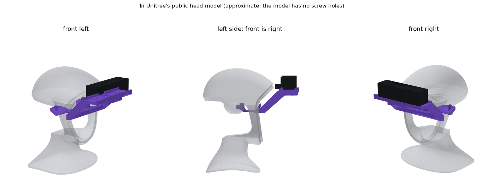
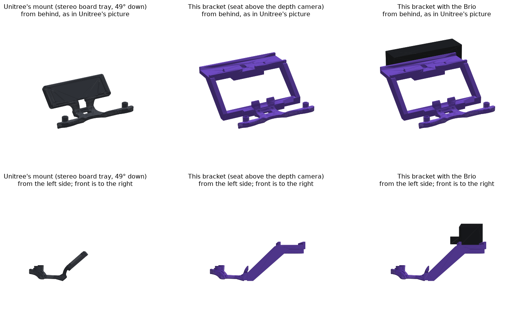

# Brio head bracket for the G1 renewed head (88 mm): trial part, version 2

A printed bracket that carries the Logitech Brio 4K in front of the G1's forehead, screwed
down where Unitree screws its own stereo camera mount
([xr_teleoperate, Device.md 5.2.1](https://github.com/unitreerobotics/xr_teleoperate/blob/main/Device.md)),
and shaped so the built-in depth camera still sees the floor.



**This is a trial part. It has not been printed or fitted.** Print it in PLA first and hold it
in the head before relying on it. The head arch in
[`../helmet_ring_mount`](../helmet_ring_mount/README.md) stays the chosen mount until this one
has been tried.

## How it follows Unitree's mount, and where it differs

Unitree's part has three sections: a flange with two vertical M4 holes 88 mm apart that screws
to the head, a thin bridge with two arms that hook out under the brow, and a tray tilted 49°
down for the stereo board.

- **Kept exactly:** the flange, the bridge and the arms, cut from Unitree's own STEP file. The
  check confirms the kept half matches Unitree's part to 0.015 mm and the holes are 88.0 mm
  apart.
- **Changed:** the tray. In Unitree's design it lies flat against the brow, which is the
  window of the built-in D435i depth camera: placed in Unitree's public head model, the tray
  blocks every one of that camera's sight lines to the talk spot. Unitree's mount replaces the
  built-in camera; our program needs both. So the tray is cut off and the new front goes round
  the window:
  - a **crossbar** under the brow, below and behind the depth lens;
  - a **plate up each side**, outside the depth camera's view;
  - a **level seat above the lens height** for the bare Brio: clip off, one ¼" screw from
    below, lips front and back so the camera can't turn (the seat from the chest bracket).
- **Not needed:** Unitree's cover plate and its USB-C clamp. Two cable-tie slots in the seat
  hold the cable.



Version 1 (12 November, morning) put two struts and the seat straight in front of the brow.
Once the bracket could be placed in the head model, that turned out wrong twice over: the
camera's back and plug cut 11 mm into the forehead, and the struts and seat blocked 41% of the
depth camera's sight lines to the talk spot. Version 2 replaces it.

## Where it sits in the head model

Unitree's public G1 model has the head's outside shape but no screw holes, so the bracket's
position was found another way: Unitree's own mount was slid around inside `head_link.STL`
until it stopped against the head without cutting into it. It fits in one place only
(2 mm higher, or 3 mm further back or forward, and it cuts in), which pins the position to
about a millimetre: bracket frame + (0.5, 0, 317) mm = torso frame. All the head checks below
use that position.

**What this does and does not prove.** It shows the bracket fits the *public model* and clears
the depth camera *as the URDF places it*. The public head may not be the renewed head, the
real brow and the real camera can differ by a few millimetres, and the model shows nothing of
the inside (where the M4 threads are). The trial print is still the real test.

## Files

| File | |
|---|---|
| `head_brio_mount_print.stl` | **Print this one.** Same part, moved so its lowest point is on the bed |
| `head_brio_mount.stl`, `.step` | The part as it sits in the head (x forward, z up) |
| `brio_dummy.stl` | The bare camera with a right-angle USB-C adapter behind it, for looking at the fit |
| `head_brio_mount.py` | Draws the part (CadQuery). Downloads Unitree's zip once, 480 kB |
| `check_head_brio_mount.py`, `check_output.txt` | The checks and their result |
| `render_compare.py`, `preview_compare.png` | Unitree's mount and this bracket drawn from the same angles |

## Parts

| Part | Notes |
|---|---|
| The printed bracket | PLA for the trial. PETG or ASA for the real one. 59 cm³, about 75 g in PETG |
| 2 × M4 × 16 screws | As Unitree's mount. They go into the head where Unitree's mount goes |
| 1 × ¼"-20 × 5/8" (16 mm) socket cap screw + 1 × M6 washer | The same screw as the chest bracket. It goes up through the seat into the camera's tripod thread |
| **Right-angle USB-C adapter** | The camera's back face is 16 mm in front of the forehead. The adapter may stand at most **13 mm** off the camera; the cable then leaves sideways. A straight plug (35 mm) does not fit |
| 2 small cable ties | Through the slots in the seat |

## Printing

- Print `head_brio_mount_print.stl` as it comes: flange at the bottom, seat on top. 120 × 116 ×
  50 mm.
- Supports from the build plate under the bridge, the crossbar, the plates and the seat.
  Unitree's own part needs them too.
- 0.2 mm layers, 4 walls, 40% infill. Clear the supports out of the screw slot and the two
  cable-tie slots.

## Fitting

Step-by-step animation (Chinese): [head-brio-install.html](https://jiaxiwang05.github.io/Unitree/head-brio-install.html).
Turn the model yourself: [camera-mounts.html](https://jiaxiwang05.github.io/Unitree/camera-mounts.html#head).

1. Find where Unitree's mount goes: two M4 threads 88 mm apart inside the renewed head, above
   the face opening. Unitree's page gives no fitting instructions, only pictures; look at the
   real head to see which way the screws go in and whether the top cap has to come off. If
   your head has no such holes, stop: this bracket cannot be fitted.
2. Hold the trial print in place before putting the camera on. The arms should come out under
   the brow the way Unitree's do, the crossbar should sit just below the brow, and the two
   plates should pass either side of the face ring without touching it.
3. Screw it down with the two M4 × 16 screws.
4. Take the clip off the Brio, sit it between the lips with the lens forward, and fasten it
   from below with the ¼" screw and washer. Don't overtighten: the camera's thread is shallow.
5. Plug in the right-angle adapter and tie the cable to the seat.

## Still to check on the robot

1. **The depth camera really sees past it.** With the camera fitted, run
   `.venv/bin/python -m greeter --check` and read the `depth` line: it should say `PASS` with
   a floor fit. If it doesn't, the program falls back to estimating the talk spot from the
   webcam.
2. **Clearances.** The model says 3.1 mm between the adapter and the forehead and 11.8 mm
   between the plates and the head. A few millimetres of difference on the real robot would
   use that up.
3. **Stiffness.** The camera hangs 81 mm in front of the screws on Unitree's 4.6 mm bridge.
   The stress is low, but check for wobble when the robot walks.
4. As for the chest bracket: the Brio's thread should be 14.5 mm from its back face (the slot
   allows ±3 mm).

## What the check found

```
watertight, one body, 59.4 cm3, 75 g in PETG; 120.3 x 116.0 x 50.4 mm
M4 holes at y +44.0 and -44.0; back half matches Unitree's part to 0.015 mm
bracket 75 g + Brio 63 g = 138 g, centre of mass 81 mm in front of the screws
Unitree's bridge under 3 g: 2.2 MPa (PETG yields near 45 MPa)
in the head model: Unitree's mount 9 of 20000 points in the head here; 2 mm higher 168
bracket and camera do not cut into the head; adapter 3.1 mm clear, plates 11.8 mm clear
depth camera's sight lines to the talk spot, 2501 from each imager:
  blocked by this bracket and the Brio: 0     by Unitree's own mount: 2501
Brio lens 1.29 m above the floor
```

Unitree's STEP leaves a few hairline cracks (under 0.3 mm long) when turned into triangles, in
the half that is kept. The script closes them; nothing moves by more than 0.03 mm.

## Rebuild

```bash
pip install cadquery trimesh pymeshfix matplotlib shapely
python ../../docs/src/fetch_g1_model.py g1mesh
python head_brio_mount.py
python check_head_brio_mount.py unitree_ref g1mesh
python render_compare.py unitree_ref
```

Unitree's mount is published by Unitree Robotics for printing; the kept half of this part is
derived from it.
