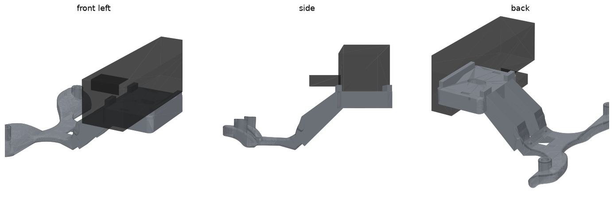

# Brio head bracket for the G1 renewed head (88 mm): trial part

A printed bracket that carries the Logitech Brio 4K at the top of the G1's face opening, built
the way Unitree builds its own stereo camera mount
([xr_teleoperate, Device.md 5.2.1](https://github.com/unitreerobotics/xr_teleoperate/blob/main/Device.md)).



**This is a trial part. It has not been printed or fitted, and two things could not be checked
on a computer** (see "Not checked"). Print it in PLA first and hold it in the head before
relying on it. The head arch in [`../helmet_ring_mount`](../helmet_ring_mount/README.md) stays
the chosen mount until this one has been tried.

## How it follows Unitree's mount

Unitree's part has three sections: a flange with two vertical M4 holes 88 mm apart that screws
to the head, a thin bridge with two arms that hook under the top of the face ring, and a tray
tilted 49° down for the stereo board.

- **Kept exactly:** the flange, the bridge and the arms, cut from Unitree's own STEP file. That
  half is known to fit the renewed head. Unitree's public G1 model is a closed shell with no
  screw holes, so it could not be redrawn from there. The check confirms the kept half matches
  Unitree's part to 0.012 mm and the holes are 88.0 mm apart.
- **Changed:** the tray is cut off. Two struts run along the line the tray took, and they carry
  a level seat for the bare Brio: clip off, one ¼" screw from below, lips front and back so the
  camera can't turn. The seat is the one from the chest bracket.
- **Not needed:** Unitree's cover plate (the Brio has its own housing) and its USB-C clamp (two
  cable-tie slots in the seat hold the cable instead).

The camera looks straight ahead, not 49° down: it has to see visitors' faces and shoulders, not
the robot's hands.

## Files

| File | |
|---|---|
| `head_brio_mount_print.stl` | **Print this one.** Same part, moved so its lowest point is on the bed |
| `head_brio_mount.stl`, `.step` | The part as it sits in the head (x forward, z up) |
| `brio_dummy.stl` | The bare camera and 20 mm of plug, for looking at the fit |
| `head_brio_mount.py` | Draws the part (CadQuery). Downloads Unitree's zip once, 480 kB |
| `check_head_brio_mount.py`, `check_output.txt` | The checks and their result |

## Parts

| Part | Notes |
|---|---|
| The printed bracket | PLA for the trial. PETG or ASA for the real one. 34.5 cm³, about 44 g in PETG |
| 2 × M4 × 16 screws | As Unitree's mount. They go into the head where Unitree's mount goes |
| 1 × ¼"-20 × 5/8" (16 mm) socket cap screw + 1 × M6 washer | The same screw as the chest bracket. It goes up through the seat into the camera's tripod thread |
| **Right-angle USB-C adapter or cable** | The camera's back face sits about 25 mm in front of the face ring. A straight plug is 35 mm long and will not fit |
| 2 small cable ties | Through the slots in the seat |

## Printing

- Print `head_brio_mount_print.stl` as it comes: flange at the bottom, seat on top. 102 × 108 ×
  40 mm.
- Supports from the build plate under the bridge, the struts and the seat. Unitree's own part
  needs them too.
- 0.2 mm layers, 4 walls, 40% infill. Clear the supports out of the screw slot and the two
  cable-tie slots.

## Fitting

Step-by-step animation (Chinese): [head-brio-install.html](https://jiaxiwang05.github.io/Unitree/head-brio-install.html).

1. Find where Unitree's mount goes: two M4 threads 88 mm apart inside the renewed head, behind
   the top of the face ring. Unitree's picture shows the head's top cap off. If your head has
   no such holes, stop: this bracket cannot be fitted.
2. Hold the trial print in place before putting the camera on. The arms should pass under the
   ring's top bar the way Unitree's do, and the seat should come out in front of the ring.
3. Screw it down with the two M4 × 16 screws.
4. Take the clip off the Brio, sit it between the lips with the lens forward, and fasten it
   from below with the ¼" screw and washer. Don't overtighten: the camera's thread is shallow.
5. Plug in the right-angle adapter and tie the cable to the seat.

## Not checked

1. **The head depth camera's view.** Our program uses the head D435i to see the talk spot on
   the floor. Without a model of the inside of the renewed head, the position of this bracket
   relative to that camera is unknown. The Brio sits higher than Unitree's tray did (its
   underside is at z 116; the tray's top edge was at 118), and only two 10 mm struts cross
   where the full-width tray was, so it should block less than Unitree's own camera. Test it:
   with the camera fitted, run `.venv/bin/python -m greeter --check` on the robot and read the
   `depth` line. It should still say `PASS` with a floor fit. If it doesn't, the program falls
   back to estimating the talk spot from the webcam.
2. **Room around the seat.** The space in front of the ring above Unitree's tray is assumed to
   be free. The trial print will show whether the seat, the camera (27 mm tall above the seat)
   or the adapter touches the ring or the visor.

Also measure, as for the chest bracket: the Brio's thread should be 14.5 mm from its back face
(the slot allows ±3 mm).

## What the check found

```
watertight, one body, 34.5 cm3, 44 g in PETG; 101.8 x 107.9 x 40.4 mm
M4 holes at y +44.0 and -44.0; back half matches Unitree's part to 0.012 mm
Brio and plug do not cut into the bracket; camera 0.5 mm clear above the lips
bracket 44 g + Brio 63 g = 107 g, centre of mass 67 mm in front of the screws
bridge stress under 3 g: 1.1 MPa (PETG yields near 45 MPa)
```

Unitree's STEP leaves a few hairline cracks (under 0.3 mm long) when turned into triangles, in
the half that is kept. The script closes them; nothing moves by more than 0.03 mm.

## Rebuild

```bash
pip install cadquery trimesh pymeshfix matplotlib
python head_brio_mount.py
python check_head_brio_mount.py unitree_ref
```

Unitree's mount is published by Unitree Robotics for printing; the kept half of this part is
derived from it.
