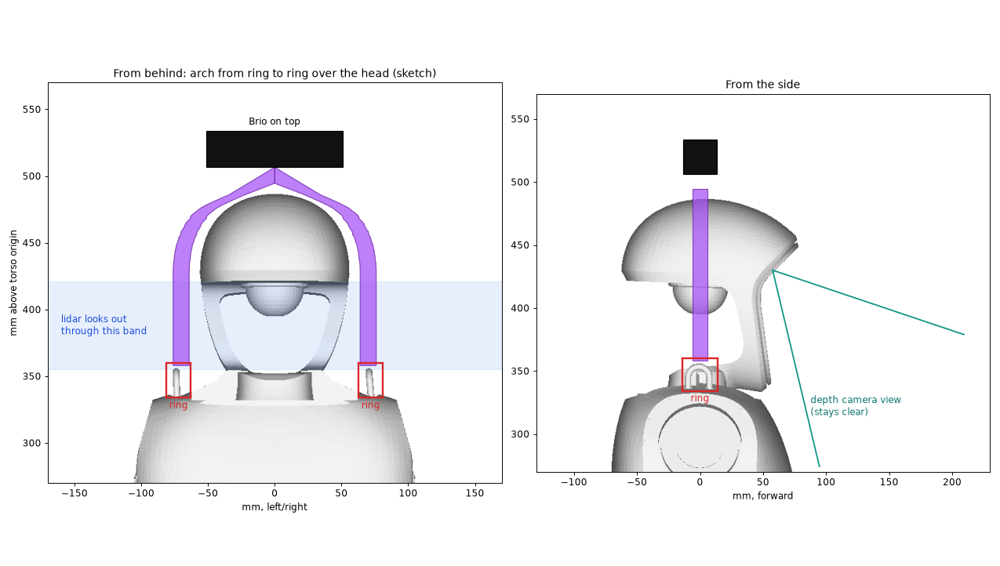
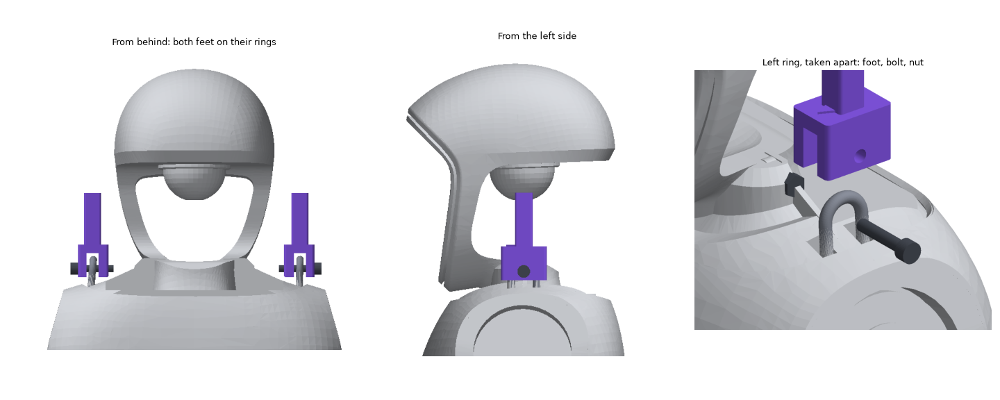
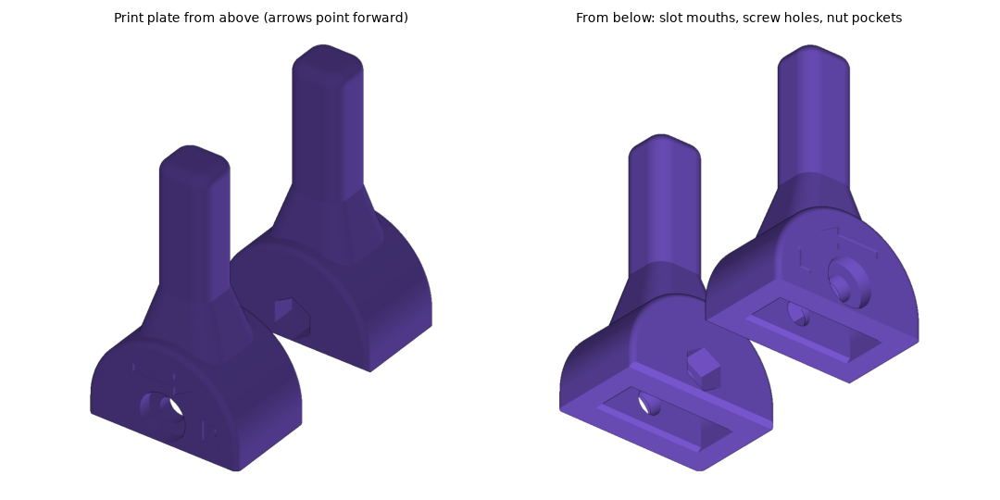
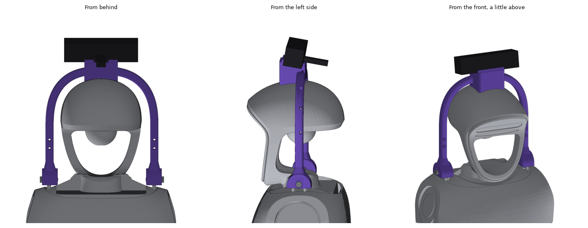
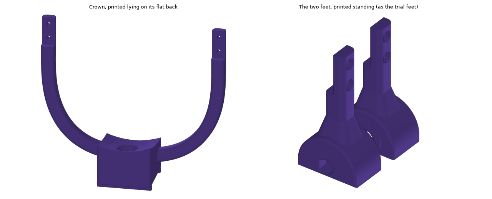

# Head arch trial feet (G1 shoulder rings)

The Brio could later sit on top of the robot's head, on an arch that runs from one shoulder
lifting ring, over the head, to the other ring. These are only the two **ends** of that arch.
Print them first, fit them on the rings and measure. The full arch is then drawn from your
numbers.

Each foot follows its ring. The slot and the outside are arches around the ring's round top, so
the wall is 5 mm all round. The leg stub flares out of the top, and the outside edges are
rounded. The slot mouth is chamfered so it finds the ring. The screw head sits in a counterbore,
and L or R and a forward arrow are engraved on the outer cheek.

## Why a trial first

The ring shape comes only from Unitree's 3D model. The real rings can differ in thickness, eye
size or spacing, and the full arch is about 15 × 18 cm and a long print. These feet take a
short print and answer those questions.

## The rings in Unitree's model

- A flat steel lug on top of each shoulder, beside the neck. It stands about 18 mm above the
  shell, and the eye faces sideways, so the bolt runs left to right.
- The eye is 11.7 mm wide with a round top (radius 5.8 mm) and straight sides down to the shell.
- The plate is 4.2 mm thick where it is flat and up to 6.2 mm across lower down.
- The centres are about 144.8 mm apart. In the model, the left ring is 71.2 mm from the centre
  line and the right one 73.6 mm, so the model is 2.4 mm asymmetric. Each foot is centred on its
  own ring.

## Parts

| Part | Notes |
|---|---|
| The two printed feet | `trial_feet_plate.stl`: both on one plate |
| 2× M5 × 20 socket cap screws | ISO 4762, A2 stainless. They go through the cheek, the ring's eye and the other cheek |
| 2× M5 nylon-insert lock nuts | DIN 985, A2. Each sits in the hex pocket on the neck side |
| 2× M5 washers | ISO 7089, A2, under the screw heads, inside the counterbore |
| 4 mm hex key and 8 mm spanner | For the screw and the nut |

**Why M5 and not M6:** the bolt has to sit high in the eye so its nut pocket stays above the
cheek bottom. With M6, the pocket would break through the bottom and the nut would sit 1.3 mm
from the shell beside the neck. M5 still leaves 1.3 mm between the bolt and the eye's round top.

## Printing

- Print both on one plate, standing as they sit on the robot: cheek bottoms on the bed, leg
  stubs up. The plate is 35 × 63 × 59 mm.
- No supports. The slot's top is an arch, the bolt holes are 5.5 mm, and the nut pockets have a
  corner pointing up, so all of them print without support.
- PLA is fine for this trial. Use 0.2 mm layers, 3–4 walls and 30 % infill. Each foot is
  14.8 cm³ solid, about 18 g if printed solid in PLA, less with infill.

## Fitting

Do this while the robot is **not** hanging from its rings, for example sitting or lying down
with the power off.

1. The feet are mirror images: L goes on the robot's left shoulder, R on its right. The letter
   and the arrow are engraved on the outer cheek; the arrow points forward, the way the robot
   faces, and the hex pocket faces the neck.
2. Slide the foot straight down over its ring until the bolt holes line up with the eye.
3. Put a washer on the M5 × 20 screw and push it in from the shoulder side: through the outer
   cheek, the ring's eye and the inner cheek. The head and washer sit in the counterbore.
4. Put the nut into the hex pocket from the neck side. Turn the screw until it just holds.
   **Don't tighten it**: the foot should still move a little.

Then check:

- The foot slides on and off the ring without force, and the ring doesn't rub hard on the slot.
- The screw went in without forcing, and the foot can move a little up and down on it.
- The cheeks don't touch the shoulder: a sheet of paper slides under them.
- The stub stands straight up beside the head without touching it.

## Measure and send

With a caliper:

1. The ring's eye: its width, and its height from the shell to the top of the eye. The model
   gives 11.7 mm wide and about 11 mm tall.
2. The ring plate's thickness at the top and near the bottom. The model gives 4.2 mm and up to
   6.2 mm.
3. The distance between the two rings, outer face to outer face and inner face to inner face.
   The model gives about 149 mm and 140.5 mm, about 144.8 mm centre to centre.
4. From the top of a ring to the top of the head. The model gives about 131 mm.
5. Whether the rings are fixed solid or can swivel or wobble.
6. A photo of each foot fitted, from behind and from the side.

## Cautions

- **Take the feet off, and later the arch, before hoisting the robot by its rings.** Never lift
  the robot by a printed part.
- The leg stubs cover about 9–10° of the head lidar's all-round view on each side, and so will
  the arch's legs. The greeter doesn't use the lidar, but walking on its own with obstacle
  avoidance would.
- Check the screws before each session: walking shakes things loose.

## What was checked, and what wasn't

Checked against Unitree's model (`torso_link_23dof_rev_1_0.STL` and `head_link.STL`) with
`check_trial_feet.py`. Its output is in `check_output.txt`.

- **Slot:** 1.19 mm (left) and 1.46 mm (right) from the ring at the closest point.
- **Shoulder shell:** the feet are 2.21 mm (left) and 3.02 mm (right) from it. Straight down
  under the cheeks, the gap is 2.50 mm and 3.52 mm.
- **Screw and nut:**
  - The screw is 1.33 mm from the eye's round top and 5 mm above the eye's bottom.
  - Screw and nut are at least 1.4 mm from the ring and at least 3 mm from the shell.
  - The nut fits in its pocket without touching the foot.
- **Head:** the stubs are at least 23.1 mm from it.
- **Overlap:** none of the robot's surface is inside either foot.

Not checked, because it needs the real robot:

- The real rings' size, shape and spacing. This is what the trial is for.
- Whether the rings are solid or can move.
- The arch itself: see "Full arch" below, drawn from Unitree's model.

## Full arch (drawn from Unitree's model)

The full arch is drawn straight from Unitree's official G1 model, without waiting for the
trial: the rings in the 23-DoF and 29-DoF rev 1.0 models are identical (eye 12.0 × about
11–12 mm, plate 4.3 mm thick, centres 71.0 mm left and 73.6 mm right of the centre line).
If the trial feet fit, the arch's feet fit too: they are the same feet.

**How it works.** Two feet hang on the rings with their M5 screws. A crown bolts onto them
with a lap joint on each leg, arches over the head and carries the Brio on top, tilted 10° up.
The weight rests on the head top through a saddle under the camera block, lined with 3 mm
foam. The ring screws only keep the arch from lifting or tipping. The lens is about
**1.365 m** above the floor (the chest mount's is 0.98 m).

### Files

| File | What it is |
|---|---|
| `helmet_crown.stl` | The crown, lying on its flat back as it prints |
| `helmet_foot_left.stl`, `helmet_foot_right.stl` | The feet, standing as they print (L and R are engraved) |
| `helmet_arch.step` | All three pieces in place, in the robot's frame |
| `helmet_*_robot_frame.stl` | The same pieces in the robot's frame, for checking |
| `helmet_arch.py` | The CadQuery model (imports `trial_feet.py` and the chest bracket's camera numbers) |
| `check_helmet_arch.py`, `check_arch_output.txt` | The check against Unitree's model and its result |

### Parts

| Part | Notes |
|---|---|
| The three printed pieces | PETG (not PLA: it creeps under load and softens in a warm hall) |
| 2× M5 × 20 socket cap screws, 2× M5 nylon-insert nuts, 2× M5 washers | ISO 4762, DIN 985, ISO 7089, A2 stainless. Feet to rings, as on the trial feet |
| 4× M3 × 12 socket cap screws and 4× M3 nuts | ISO 4762 and ISO 4032, A2. Two per lap joint: heads at the back, nuts in the hex pockets on the front of the feet |
| 1× ¼"-20 UNC × 5/8" socket cap screw and 1× M6 washer | ASME B18.3 and ISO 7089. Holds the Brio from below, 4.0 mm into its thread, as on the chest bracket |
| 3 mm adhesive EVA foam, about 50 × 50 mm | On the saddle under the camera block. Cut a hole for the screw pocket |
| 4 cable ties, 2.5–3.6 mm wide | One holds the USB-C plug down at the back lip, three hold the cable on the left leg |
| Hex keys 2.5 mm, 4 mm and 3/16", 8 mm spanner | For the M3, M5 and ¼" screws and the M5 nuts |

### Printing

- **Crown:** lying on its flat back (the side facing the back of the robot), no supports. It is
  135 × 156 × 37 mm, so it fits a 256 mm bed. The only real overhang is the roof of the screw
  pocket under the camera, a 16 mm bridge.
- **Feet:** standing as they sit on the robot, like the trial feet, no supports. 35 × 22 × 68 mm each.
- PETG, 0.2 mm layers, 4 walls, 30–40 % gyroid infill. Solid, the three pieces weigh 124 g
  (crown 88 g, feet 18 g each); with infill they come out lighter. With the Brio (about 63 g),
  the head carries under 190 g.

### Assembly

Do it with the robot sitting or lying down, powered off and **not** hanging from its rings.

1. Stick the foam on the saddle under the camera block. Cut a hole for the screw pocket.
2. Off the robot: pull the clip off the Brio and set the bare camera on the seat between the
   lips, lens forward, USB-C socket at the back over the gap in the back lip. Put the M6 washer
   on the ¼" screw, push it up through the pocket from the saddle's underside and screw it in by
   hand about three turns (4 mm), then just snug it. If it stops sooner, take it out and add a
   second washer.
3. Fit the feet on the rings as for the trial: L on the left shoulder, R on the right, arrows
   forward, M5 × 20 screw with a washer from the outside, nut in the pocket on the neck side.
   Snug, not tight.
4. Lower the crown over the head so its legs' back halves sit behind the feet's front halves
   and the saddle rests on the head. Push the M3 × 12 screws in from the back through both
   halves into the nuts in the front pockets, and tighten gently.
5. Plug in the USB-C cable. Tie the plug down with a cable tie through the tunnel under the back
   lip. Run the cable down the back of the head to the left leg, tie it at the three tunnels near
   the leg's back face, and on to a USB-C port at the back of the neck. Leave some slack.
6. Check that the saddle rests on the foam, the arch doesn't rock, and nothing else touches the
   head.

### What was checked (`check_arch_output.txt`)

- **Rings and shoulders:** the same numbers as the trial feet: at least 1.19 mm from the rings,
  2.2 mm from the shoulder shell; the screws and nuts at least 1.4 mm from the rings.
- **Head:** the arch is at least 9 mm from the head outside the camera block. The saddle sits
  2.6–3.0 mm above the head top (median 2.8 mm), right for 3 mm foam. The feet are at least 15 mm
  from the head, the Brio and its plug 25 mm.
- **Brio's view:** none of 1,575 rays across the 66° × 52° picture (640 × 480) is blocked by the
  arch or the head. The view reaches 16° below level and 36° above.
- **Head depth camera:** none of its 1,275 sight lines to the talk spot (0.6–1.4 m ahead,
  ±0.6 m, floor to thigh height) is blocked; the arch is at least 73 mm from all of them.
- **Head lidar:** each leg casts a new 10° shadow in the lidar's all-round view. The feet sit
  25–42° below the lidar, so their extra shadow falls on the floor 1.4–2.7 m out to each side,
  where the arms already block part of the view.
- **Lens:** 529 mm above the torso origin, about 1.365 m above the floor.
- All three pieces are watertight solids and fit a 256 mm bed.

Not checked, because it needs the real robot: the real rings and head shell (Unitree's model
could differ slightly), the real head-top shape under the saddle (fitted to the model within
−0.2 to +0.9 mm; the foam takes this up), whether the arch stays put when the robot walks, and
the arms: raising them high to the sides could reach the legs.

### Cautions for the full arch

- **Take the arch off before hoisting the robot by its rings.** Undo the two M5 screws; the
  arch lifts off in one piece.
- The legs shade about 10° of the head lidar's view on each side; anything that relies on the
  lidar (walking on its own, obstacle avoidance) should be tested with the arch on.
- Check all six screws before each session: walking shakes things loose.
- The greeter was tuned for the chest camera: after moving the Brio to the head, re-run the
  distance calibration (`python -m greeter.robot.calibrate --distance`).
